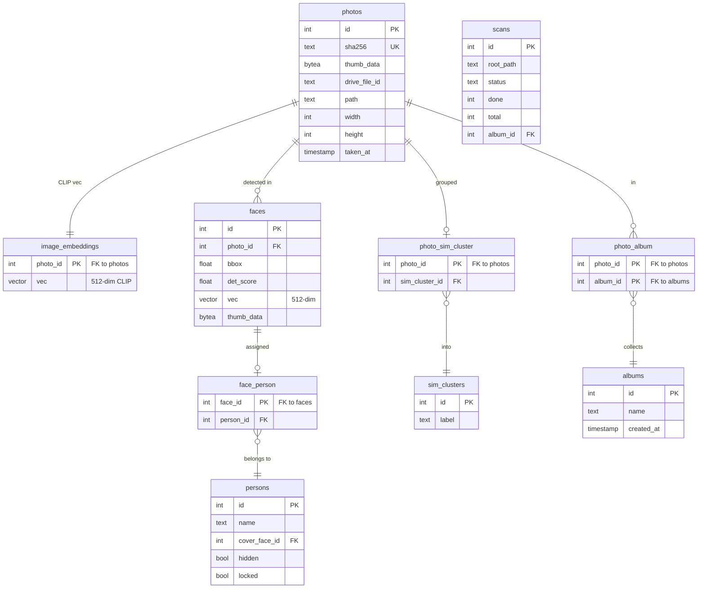
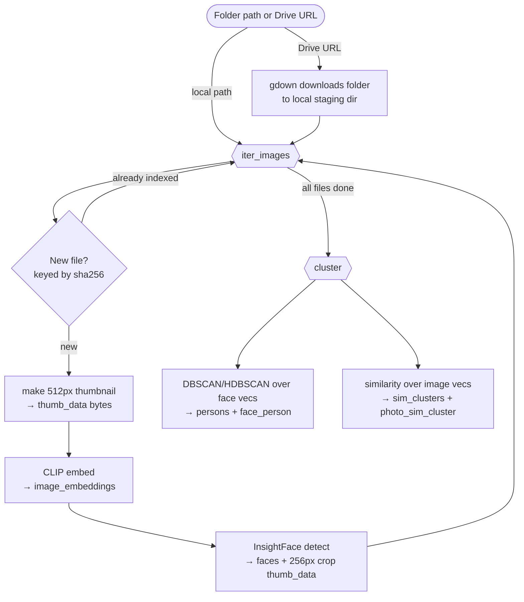
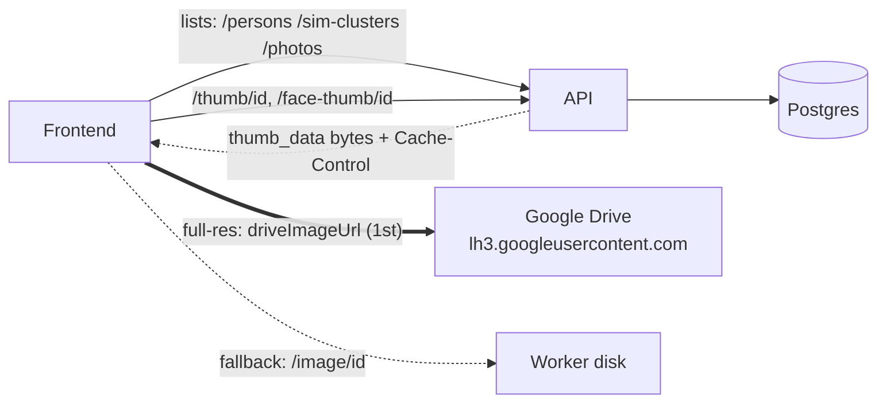
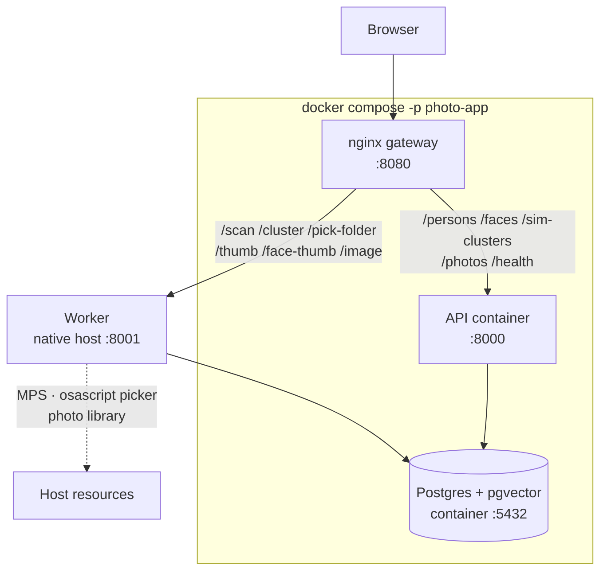
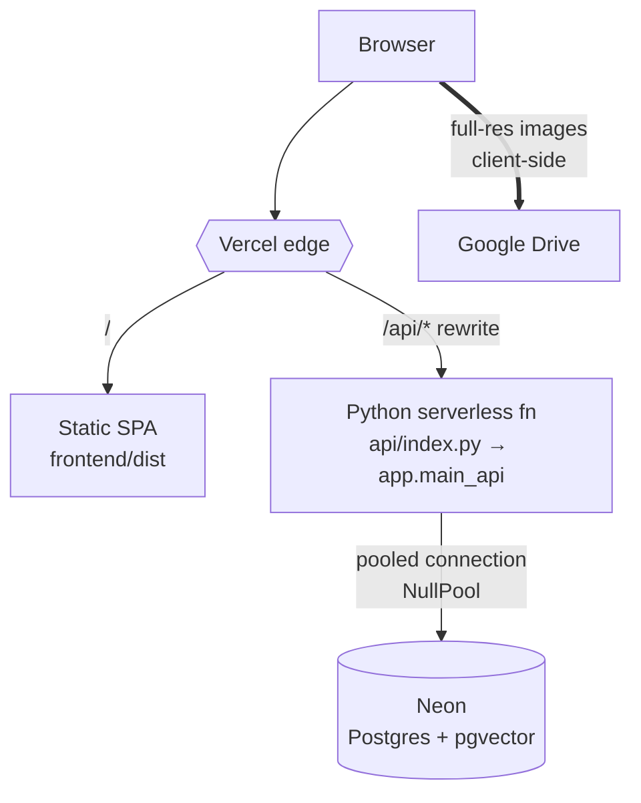

# Architecture

PhotoCluster groups a photo library by **face** (who is in each photo) and by
**visual similarity** (near-duplicate / same-scene sets), and lets you browse and
curate the result. This document describes the system's shape: its components,
how data flows through them, and the two deployment topologies (full local stack
vs. the no-worker Vercel viewer).

## Components

| Component | Tech | Role |
|---|---|---|
| **Frontend** | React 18 + Vite + TypeScript, Tailwind (Material-3 tokens) | SPA: People / Similar / All Photos views, lightbox, curation UI. |
| **Worker** | FastAPI (`app.main_worker`), native host process | Heavy ML + ingest: scan pipeline, CLIP + InsightFace embedding, clustering, Google Drive download, folder picker. Serves original images. |
| **API** | FastAPI (`app.main_api`), slim Docker / serverless | DB-only surface: persons, similarity, photos, and in-DB thumbnails. No ML stack. |
| **Database** | Postgres + pgvector | Source of truth: photos, embeddings, faces, persons, clusters, thumbnail bytes. |
| **Gateway** | nginx (local) / Vercel rewrites (prod) | One origin; routes paths to worker vs. API. |
| **Google Drive** | — | Optional source of originals; also the display source for full-resolution images in the browser. |

The split line is deliberate: the API's routers (`persons`, `sim`, `photos`,
`media`) import only `db` / `models` / `schemas`, never `analyzer` / `clusterer`
/ `pipeline` / Pillow. So the API image carries none of torch/InsightFace/CLIP and
stays small and portable (including serverless).

### Three app entrypoints, one package

All three import the same `app` package (shared `db`, `models`, `schemas`,
`config`); they differ only in which routers they mount:

- `app.main_worker` — `scan`, `cluster`, `media` + the pipeline/analyzer/clusterer.
- `app.main_api` — `persons`, `sim`, `photos`, `media`, `/health`.
- `app.main` — the combined all-in-one, for simple local dev.

`media` is mounted by both the worker and the API. On the worker it can read
original files and face crops from disk; on the API it serves thumbnail **bytes**
stored in the database (see below), so it needs no shared filesystem.

## Data model

Key points:

- **`sha256`** keys a photo by content, so re-scanning a folder is idempotent.
- **Vectors** are pgvector `vector(512)` with ivfflat cosine indexes; queries set
  `ivfflat.probes = 50` per connection for near-exact recall at this scale.
- **`thumb_data`** (on `photos` and `faces`) holds the JPEG bytes of the 512 px
  photo thumbnail / 256 px face crop. Storing them in the DB removes the only
  shared-filesystem dependency of the read path, which is what makes serverless
  deployment possible. `thumb_path` remains as a local-dev fallback.
- **`drive_file_id`** links a photo to its Google Drive file so the browser can
  display the full-resolution image straight from Drive.
- **`persons.locked`** marks a curated person; locked persons are preserved
  verbatim across re-clustering instead of being rebuilt.
- **`albums`** are user-named collections; `photo_album` is a many-to-many join,
  so a photo can sit in several albums. A scan may carry an `album_id`, in which
  case every photo it touches (new or already-indexed) is added to that album —
  "scan this folder straight into *Wedding*". Album create/rename/delete and
  manual add/remove are plain DB writes, so they work in the no-worker viewer
  too.

## Data flow

### Ingest (worker only)

Scanning runs in a background thread, committing every 10 files and updating
`scans.done` so the UI can poll progress. Per-file failures are recorded on
`photos.error` and never abort the run.

### Display (read path)

- **Lists** (People, Similar, All Photos): the frontend calls the API, which reads
  Postgres and returns JSON. Each photo/face carries its `drive_file_id`.
- **Thumbnails / face crops**: `GET /thumb/{id}` and `/face-thumb/{id}` return the
  `thumb_data` bytes with a long-lived `Cache-Control`, so browsers and any CDN
  cache them and a grid of many thumbnails doesn't re-hit the backend.
- **Full-resolution photo** (lightbox): the frontend builds an ordered source list
  `[driveImageUrl, imageUrl]`. A Drive-backed photo loads full-res directly from
  Google (`lh3.googleusercontent.com/d/<id>`); otherwise it falls back to the
  worker's `GET /image/{id}` (the original file on disk). All image tags use
  `referrerPolicy="no-referrer"` — sending a `Referer` to Drive triggers HTTP 429.

## Deployment topologies

### Full local stack

The worker runs natively (not containerized) to keep Apple-Silicon MPS, the
`osascript` folder picker, and direct access to the photo library. `db` and `api`
and the `frontend`/gateway run under `docker compose -p photo-app`. Single origin
through nginx means no CORS in normal use.

### No-worker viewer on Vercel

What changes versus local:

- **No worker.** Scan / cluster / folder import / original-image serving are not
  deployed. The data is prepared locally and loaded into Neon; prod is browse +
  curate only. The frontend hides scan UI when `VITE_NO_WORKER=1`.
- **Single function, mounted under `/api`.** `api/index.py` mounts `app.main_api`
  at `/api` and the frontend sets `VITE_API_BASE=/api`, so `/api/persons` →
  `/persons` inside the app. `vercel.json` rewrites `/api/*` to the function;
  everything else is the static SPA (one origin, no CORS).
- **Connectionless engine.** `api/index.py` forces `PHOTO_SERVERLESS=1`, so
  `app.db` builds the engine with `NullPool`. Each short-lived invocation opens
  and closes its own connection and relies on Neon's pooled endpoint, instead of
  keeping a per-instance pool that would exhaust Neon's connection limit across
  cold starts.
- **Images.** Thumbnails come from `thumb_data` in Neon; full-resolution comes from
  Drive. `/image/{id}` has no files to serve in this topology and 404s — benign,
  because the lightbox tries Drive first.

See `docs/deploy-vercel.md` for the step-by-step deploy process.

## Design decisions worth knowing

- **Thumbnails in the DB.** Trades a larger database (~370 MB for ~1,800 photos +
  ~10,000 faces) for a stateless read path that deploys anywhere. The alternative
  — object storage (S3/R2/Vercel Blob) — scales better but adds a service and a
  migration; the DB approach is the simplest thing that makes serverless work.
- **Drive for originals.** Keeps multi-GB originals out of the DB and off the
  server. Caveat: Drive's image endpoints are undocumented and rate-limit bulk
  hotlinking, so they suit a personal viewer, not a high-traffic gallery.
- **Worker stays native.** The ML stack wants a real, long-running process (and
  ideally a GPU/MPS). It is intentionally excluded from the serverless and slim
  Docker surfaces rather than forced into them.
